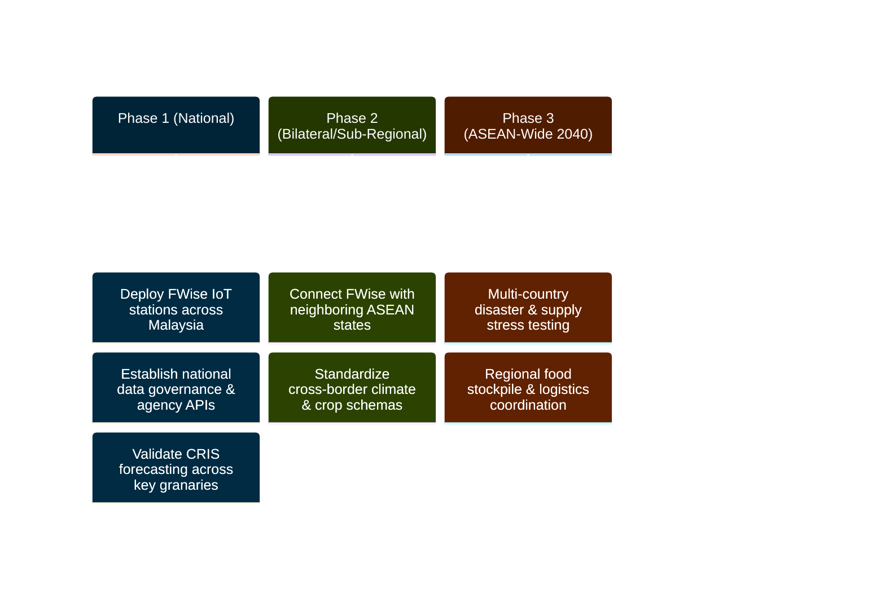

<!-- Animated Blue Wave Header -->
<div align="center">
  

  <!-- Animated Typing Subtitle -->
  <a href="https://git.io/typing-svg">
    
  </a>

  <br/>

  <!-- Blue-Themed Badges -->
  <p>
    
    
    
    
  </p>
</div>

---

## 🏆 Competition Recognition

<table>
  <tr>
    <td width="50%">
      <h3>🇲🇾 Malaysia National Finalist</h3>
      <b>Event:</b> ASEAN Data Science Explorers (ASEAN DSE) 2026<br/>
      <b>Organizers:</b> ASEAN Foundation & SAP<br/>
      <b>Institution:</b> Universiti Teknologi Malaysia (UTM)
    </td>
    <td width="50%">
      <h3>👥 Team JJ Vision</h3>
      <ul>
        <li><b>Tan Jia Wei</b></li>
        <li><b>Wong Jun Xiang</b></li>
      </ul>
      <i>"How can we turn climate information into food security resilience?"</i>
    </td>
  </tr>
</table>

---

## 🌊 The Problem & Systemic Root Causes

Globally, **1 in 4 people (2.5 billion)** went without reliable access to sufficient food in 2025, while across ASEAN, **12.8% of the population (87.6 million people)** experienced moderate or severe food insecurity between 2023 and 2025 (reaching **40.0%** in Cambodia, **35.6%** in Lao PDR, **32.9%** in the Philippines, **32.7%** in Myanmar, and **16.7%** in Malaysia).

In Malaysia, climate change acts as a **threat multiplier**—simultaneously activating production, water, supply-chain, and import vulnerabilities:

* 🌾 **Production & Pest Vulnerabilities:** Malaysia's rice Self-Sufficiency Ratio (SSR) fell to **52.9%** in 2024 as paddy output declined **5.3%** (from 2.18M to 2.06M tonnes). Other critical SSR deficits include mutton (**8.5%**), ginger (**15.5%**), beef (**16.8%**), and mango (**20.6%**). Biological threats like Brown Planthopper (up to **60%** rice loss) and Bacterial Panicle Blight (**50%** yield loss across 12,000+ ha) further compound crop risks.
* ❄️ **Post-Harvest & Infrastructure Fragility:** Severe lack of mobile cold-storage facilities, low-temperature warehouses, and temporary storage hubs accelerates post-harvest losses. In 2024, floods caused **RM303.4M** in public infrastructure damage and **RM54.1M** in business premises damage, disrupting food distribution.
* 📦 **Heavy Food Import Dependence:** Food imports jumped **19.1%** in 2024 to **RM93.8 billion**, with extreme Import Dependency Ratios (IDR) in mango (**116.7%**), apple (**100%**), garlic (**100%**), onion (**100%**), shallot (**99.9%**), mutton (**92.1%**), mushroom (**89.3%**), ginger (**86.9%**), and beef (**83.5%**). FAO projects Malaysia's 2026 paddy output at **2.1M tonnes** (-4.5% below the 5-year average), pushing 2026/27 cereal import needs to **7.9M tonnes** (+10% above average).
* ⛈️ **Escalating Flood Losses & Macro Risk:** Flood incidents surged **66.3%** from 2023 to 2024 (809 to 1,345 incidents), raising agricultural losses **53.5%** from **RM120.6M to RM185.2M** (including **RM158.7M** in Kedah paddy losses across 2,047 ha / 57,323 tonnes), followed by **RM52.6M** in 2025 across all states. A 10% food price spike drives **+3.5%** food insecurity and up to **+6.1%** severe child wasting, while the World Bank warns a 1-in-20-year flood could cost Malaysia **4.1% of GDP by 2030**.

### 🔍 Four Systemic Root Causes
1. **Fragmented Information:** Climate, hydrological, and agricultural datasets sit in isolated agency silos without a unified multi-hazard early-warning strategy.
2. **Critical Information Gaps:** **40%** of 143 critical climate and agricultural data items in Malaysia were unavailable, with only **18%** readily accessible.
3. **Prediction-Action Gap:** Existing forecasting struggles to translate raw weather warnings into localized, role-specific operational actions.
4. **Insufficient Resilience:** Weak recovery and adaptation leave the agrofood sector exposed to recurring shocks.

---

## 💡 System Architecture & Workflow

**FWise (FoodWise)** operates on a hybrid architecture combining **Automated Intelligence (CRIS)**, **User-Triggered Simulations**, and **Human Decision & Action**:

```mermaid
%%{init: {'theme': 'base', 'themeVariables': { 'primaryColor': '#0077B6', 'primaryTextColor': '#ffffff', 'primaryBorderColor': '#03045E', 'lineColor': '#00B4D8', 'secondaryColor': '#CAF0F8', 'tertiaryColor': '#90E0EF'}}}%%
flowchart LR
    A["📡 FWise IoT Stations<br/>(14-Component AWS Array)"] -->|4G / LoRaWAN / Satellite| B["🔗 Integrated Data Hub<br/>(MET, JPS, MADA, DOA, DOSM)"]
    B --> C["🧠 CRIS AI Engine<br/>(Anomaly & Stress Testing)"]
    C --> D["⚖️ Strategy Planner<br/>(7-Criteria Ranking)"]
    D --> E["📱 Stakeholder App & Portal<br/>(Directives & Evidence Audit)"]
    
    style A fill:#03045E,stroke:#00B4D8,stroke-width:2px,color:#fff
    style B fill:#023E8A,stroke:#00B4D8,stroke-width:2px,color:#fff
    style C fill:#0077B6,stroke:#90E0EF,stroke-width:2px,color:#fff
    style D fill:#0096C7,stroke:#CAF0F8,stroke-width:2px,color:#fff
    style E fill:#00B4D8,stroke:#03045E,stroke-width:2px,color:#000
```



### Dual User Roles
* **🏛️ Government & Coordinating Agencies (Main CRIS Web Platform):** Monitor live regional risk dashboards, receive automated CRIS alerts, run "What-If" disaster stress tests, compare AI-ranked response strategies, and authorize official multi-agency directives.
* **🚜 Implementation Users (FWise Stakeholder Mobile App):** Registered food producers, millers, and logistics operators receive assigned action directives, view localized forecasts, update completion percentages in real time, and upload verification evidence.

---

## 📡 FWise IoT Field Station Hardware & Baseline Thresholds

Each solar-powered **FWise Automatic Weather Station (AWS)** comprises **14 integrated hardware components** streaming continuous ground-truth telemetry into CRIS:

| # | Component | Parameter Measured | Baseline / Reference Threshold |
| :-: | :--- | :--- | :--- |
| 1 | **Anemometer** | Wind speed, gust & average | $\approx 2.0\text{ m/s}$ |
| 2 | **Wind Vane** | Prevailing wind direction | Directional vector |
| 3 | **Air Temperature Sensor** *(Radiation Shield)* | Min, max & mean air temperature | $\approx 27\text{--}28^\circ\text{C}$ |
| 4 | **Relative Humidity Sensor** *(Radiation Shield)* | Mean RH, dew point & VPD | $\approx 80\%$ |
| 5 | **Tipping-Bucket Rain Gauge** | Annual rainfall & hourly intensity | $\approx 2,500\text{ mm/yr}$ ($0\text{--}10\text{ mm/h}$ normal) |
| 6 | **Pyranometer** | Global solar radiation ($W/m^2$) | $\approx 18\text{ MJ/m}^2/\text{day}$ |
| 7 | **Barometric Pressure Sensor** | Mean sea-level pressure | $\approx 1,010\text{ hPa}$ |
| 8 | **Soil Monitoring Array** *(10cm / 40cm)* | Soil moisture (% VWC), temp & EC | $27\text{--}30^\circ\text{C}$; $0\text{--}2\text{ dS/m}$ non-saline |
| 9 | **Acoustic Water Level / Flood Sensor** | Canal stage, rate of rise & flood level | DID Alert / Warning / Danger thresholds |
| 10 | **Data Logger & Edge Controller** | Local buffering & telemetry processing | Continuous edge logging |
| 11 | **Communication Antenna** | Multi-network telemetry uplink | 4G / 5G, LoRaWAN, or Satellite |
| 12 | **Solar Power System** | Solar panel, charge controller & battery | Off-grid 24/7 operation |
| 13 | **Station Health Indicator** | Power, sensors, comms & battery status | On-site LED & remote diagnostics |
| 14 | **Mounting Pole & Mast Structure** | Galvanized mast, brackets & lightning protection | Concrete foundation |

*(Additional canopy monitoring via Multi-Spectrum Canopy Health NDVI Camera)*

---

## 🧮 Mathematical & Analytical Framework (CRIS Engine)

The CRIS decision-support engine evaluates hazard risk and ranks response strategies across seven multidimensional criteria:

### 1. Climate-Risk Scoring Model
Calculates composite hazard risk score $R_h$ by aggregating weighted standardized environmental abnormality scores $S_i$:

$$R_h = \sum_{i=1}^{n} w_{h,i} S_i$$

* $R_h$: Risk score for climate hazard $h$
* $S_i$: Standardized abnormality score of environmental variable $i$
* $w_{h,i}$: Weight assigned to variable $i$ for hazard $h$

### 2. Affected Agricultural Area & Projected Production Loss
Computes impacted acreage ($A_{\text{affected}}$) using zone impact indicators $I_i \in [0,1]$, then estimates total crop yield lost ($L_{\text{loss}}$) and percentage loss:

$$A_{\text{affected}} = \sum_{i=1}^{n} A_i I_i \qquad \text{and} \qquad L_{\text{loss}} = A_{\text{affected}} \times Y_{\text{baseline}} \times L_{\text{rate}}$$

$$\text{Projected Crop Loss (\%)} = \frac{L_{\text{loss}}}{P_{\text{production}}} \times 100\%$$

* $A_i$: Area of agricultural zone $i$ ($\text{ha}$)
* $Y_{\text{baseline}}$: Expected baseline crop yield ($\text{tonnes/ha}$)
* $L_{\text{rate}}$: Estimated percentage production-loss rate
* $P_{\text{production}}$: Expected production without the climate event ($\text{tonnes}$)

### 3. Residual Food Deficit, Implementation Cost & Economic Exposure
Evaluates supply shortfalls ($RD$), total intervention budget ($C_s$), and remaining asset vulnerability ($E_s$) under strategy $s$:

$$RD = \text{Demand} - \text{Supply}_{\text{available}} \qquad \text{and} \qquad C_s = \sum_{k=1}^{m} C_{k,s}$$

$$E_s = \sum_{j=1}^{n} Q_{j,s} V_j \qquad \text{and} \qquad L_{AS} = L_0 - L_s$$

* $Q_{j,s}$: Quantity of asset/resource $j$ remaining at risk under strategy $s$
* $V_j$: Monetary value per unit of asset $j$ ($\text{RM}$)
* $L_0, L_s$: Unmitigated baseline loss vs. post-intervention loss ($L_{AS}$ = loss avoided)

### 4. Overall Strategy Resilience Score
Normalizes candidate performance metrics $N_{j,s}$ across evaluation criteria $j$ to compute the composite Resilience Score ($RS_s$):

$$RS_s = \sum_{j=1}^{n} W_j N_{j,s}$$

* $RS_s$: Overall resilience score for strategy $s$
* $N_{j,s}$: Normalized performance score of criterion $j$
* $W_j$: Priority weight assigned to evaluation criterion $j$

---

## 📍 Pilot Validation: Kedah Paddy Granary (MADA)

FWise was piloted and stress-tested in **Kedah**—Malaysia's rice bowl (**228,963 ha** planted area; **947,621 tonnes** annual paddy production; **RM5.0M** flood losses in 2025)—across **6 deployed field stations** (`FS-KDH-01` to `FS-KDH-06`) covering MADA Blocks I–IV.

### Simulated Scenario: Severe Monsoon Deluge & Tidal Lock (April – August 2026)
* **Trigger:** +38% rainfall anomaly, >82% 14-day soil saturation, +42% catchment runoff, and astronomical spring high tides obstructing estuary gravity discharge at Sungai Kedah & Sungai Muda (> +2.4m bund elevation) for **12 days** during critical grain ripening.
* **Exposure:** **9,450 ha** of standing MR297 paddy, **3,978 farm households**, and **11 industrial rice mills**.
* **Recommended Plan (`STRAT-5` — Resilience Score: 94/100):** Synchronizes **METMalaysia** 15-min Doppler nowcasting, **JPS/MADA** pre-emptive canal drawdown (-0.5m MSL) and 12 mobile pump skids, **DOA/PPK** accelerated combine harvesting across 3,800 ha, **BERNAS** 24-hour grain drying & 2,000t reserve release, and **Logistics** freight rerouting.

| Impact Metric | Without FWise (Unmitigated) | With FWise (`STRAT-5` Action Plan) | Net Improvement |
| :--- | :---: | :---: | :---: |
| ⏱️ **Preparation Lead Time** | Reactive / Late | **4 – 6 Weeks** | Proactive mobilization |
| 🌾 **Projected Crop Loss** | 21.7% | **7.8%** | **-13.9% loss avoided** |
| 📉 **Food Supply Deficit** | 4,500 tonnes | **829 tonnes** | **81.6% deficit reduction** |
| 💰 **Economic Exposure** | RM 21.80 Million | **RM 1.41 Million** | **RM 20.39M saved** |

---

## 🤝 Multi-Sector Stakeholder Ecosystem

| Stakeholder Group | Key Partners & Agencies | Role in FWise |
| :--- | :--- | :--- |
| **Government & Policymakers** | METMalaysia, JPS, MADA, DOA, NADMA, KPKM, KPDN, DOSM, MITI, Ministry of Economy | Provide policies, funding, verified hazard/crop data, and coordinated executive directives. |
| **Producers & Supply Chain** | BERNAS, MARDI, NAFAS, FAMA, FELDA, PPK, Millers & Logistics Operators | Contribute ground data and execute field, milling, storage, and transport directives. |
| **Tech & Research Partners** | SAP, MDEC, MRANTI, Universiti Teknologi Malaysia (UTM), UPM | Build AI forecasting, IoT hardware, cloud infrastructure, and analytical models. |
| **Communities & NGOs** | Yayasan Food Bank Malaysia, MERCY Malaysia, Malaysian Red Crescent | Coordinate last-mile food distribution and support vulnerable communities. |

---

## 💰 Estimated Deployment Budget (Pilot Architecture)

* **FWise IoT Field Station (Per Unit):** **RM 19,000** total (`RM 15,500` sensors, logger, 4G/LoRaWAN module, solar power & mast + `RM 3,500` civil foundation & installation).
* **Software & Cloud Infrastructure:** **RM 40,000** one-time platform development (UI/UX, web/mobile apps, CRIS risk engine, scenario simulator & security) + **RM 500/month (RM 6,000/year)** cloud hosting (AWS IoT Core, API server, database & storage).

---

## 🌏 Regional Scalability Roadmap (ASEAN Vision 2040)



> **Final Vision:** *"A climate-resilient ASEAN with sufficient, safe, and accessible food for all by 2040."*

---

## 🎯 UN SDGs & Policy Alignment

| SDG | Alignment & Target Contribution |
| :--- | :--- |
| **SDG 2: Zero Hunger** | Protects access to nutritious food (2.1), smallholder productivity/incomes (2.3), and resilient agricultural practices (2.4). |
| **SDG 11: Sustainable Cities** | Decreases direct economic losses caused by climate disasters *(Target 11.5)*. |
| **SDG 12: Responsible Production** | Reduces pre-harvest and post-harvest food losses across supply chains *(Target 12.3)*. |
| **SDG 13: Climate Action** | Strengthens adaptive capacity and multi-hazard early-warning infrastructure *(Target 13.1)*. |
| **AEC Blueprint 2025** | Directly supports Characteristic 5.3.3: *Ensure integrated food security information*. |

---

## 📂 Repository Structure

```text
├── docs/
│   └── MALAYSIA_JJVISION_Presentation_slide.pdf   # Official ASEAN DSE 2026 Finalist Pitch Deck
├── analytics/
│   └── sac_storyboard_exports/                    # SAP Analytics Cloud (SAC) models & visualizations
├── cris_engine/
│   ├── risk_scoring.py                            # Climate anomaly & hazard risk scoring model
│   └── stress_test_simulator.py                   # Crop loss & multi-criteria strategy optimizer
├── hardware_specs/
│   └── field_station_bom.md                       # 14-component IoT AWS architecture & BOM
└── README.md
```

---

<!-- Animated Blue Wave Footer -->
<div align="center">
  
</div>
